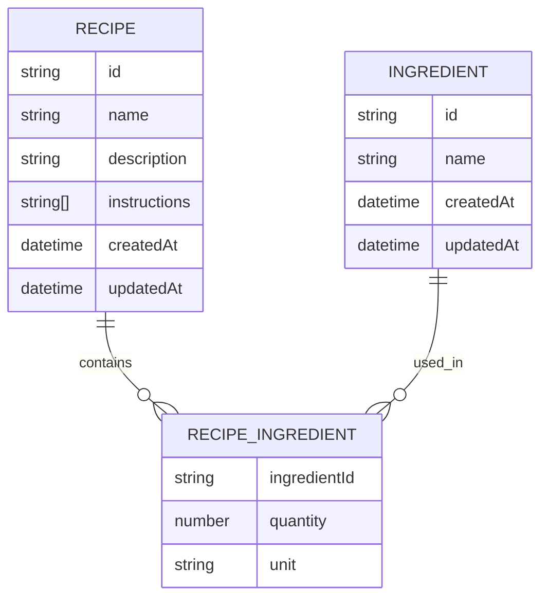

# Meal Finder Backend

This backend implements the recipe idea from the business model screenshots: a user can store recipes, store ingredients, connect recipes to ingredients, and search for recipes that match selected ingredients.

## Technology

- Node.js
- Express.js
- JSON file storage in `data/db.json`

## Schema Diagram

## Data Entities

### Recipe

The Recipe entity represents a meal recipe stored in the application.

Attributes:

| Name | Description |
| --- | --- |
| `id` | Unique recipe identifier |
| `name` | Name of the recipe |
| `description` | Short description of the dish |
| `instructions` | Cooking instructions stored as ordered text steps |
| `ingredients` | List of required ingredients with quantity and unit |
| `createdAt` | Date when the recipe was created |
| `updatedAt` | Date when the recipe was last updated |

### Ingredient

The Ingredient entity represents an ingredient that can be used in recipes.

Attributes:

| Name | Description |
| --- | --- |
| `id` | Unique ingredient identifier |
| `name` | Name of the ingredient |
| `createdAt` | Date when the ingredient was created |
| `updatedAt` | Date when the ingredient was last updated |

## DAO Methods

### Ingredient DAO

- `listIngredients()`
- `getIngredientById(id)`
- `createIngredient({ name })`
- `updateIngredient(id, { name })`
- `deleteIngredient(id)`
- `listRecipesForIngredient(id)`

### Recipe DAO

- `listRecipes(query)`
- `getRecipeById(id)`
- `createRecipe(recipeInput)`
- `updateRecipe(id, recipeInput)`
- `deleteRecipe(id)`

## API Endpoints

### Health

| Method | Endpoint | Description |
| --- | --- | --- |
| `GET` | `/health` | Checks if the backend is running |

### Ingredients

| Method | Endpoint | Description |
| --- | --- | --- |
| `GET` | `/api/ingredients` | Lists all ingredients |
| `POST` | `/api/ingredients` | Creates a new ingredient |
| `GET` | `/api/ingredients/:id` | Gets one ingredient |
| `PUT` | `/api/ingredients/:id` | Updates one ingredient |
| `DELETE` | `/api/ingredients/:id` | Deletes one ingredient |
| `GET` | `/api/ingredients/:id/recipes` | Lists recipes that use an ingredient |

### Recipes

| Method | Endpoint | Description |
| --- | --- | --- |
| `GET` | `/api/recipes` | Lists all recipes |
| `POST` | `/api/recipes` | Creates a new recipe |
| `GET` | `/api/recipes/:id` | Gets one recipe |
| `PUT` | `/api/recipes/:id` | Updates one recipe |
| `DELETE` | `/api/recipes/:id` | Deletes one recipe |
| `GET` | `/api/recipes?ingredientIds=ing-salt,ing-pepper` | Searches recipes containing all selected ingredients |
| `GET` | `/api/recipes/search/by-ingredients?ingredientIds=ing-salt,ing-pepper` | Alternative search endpoint |

